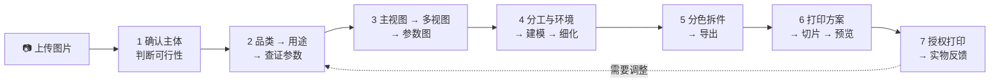

<div align="center">

# 🎨 文创大师 · wenchuang-master

**一张图片 → 一件能真正打印出来的文创产品**

把照片、插画、图案或设计稿，通过和 AI 一步步共创，变成手机支架、笔筒、钥匙扣、解压玩具等可以 3D 打印的实用文创。


</div>

---

## ✨ 它能做什么

你上传一张图，比如自家的猫、一个吉祥物、一幅插画，告诉 AI 你想把它做成文创。文创大师会带着 AI 助手，像一位有经验的产品设计师一样陪你走完全程：

- 🔍 **认出图里的主体**：确认你想保留哪些特征
- 🧭 **判断能不能做**：从外观、功能、整合、制造四个角度评估可行性
- 💡 **一起想用途**：从 **12 大类、71 个产品原型**里给出方向，也可以继续要更多选项
- 📐 **出图纸**：主视图、多视图、带尺寸的参数图，逐张确认
- 🧱 **建模**：Tripo 生成个性化外观，Blender 代码构建精确的功能结构，两者整合
- ⚙️ **加入互动机构**：从 **15 张经过许可核对的机构卡片**（铰链、卡扣、弹簧夹、可动关节等）中复用成熟结构
- 🖨️ **切片与打印**：分色拆件、导出、在 Bambu Studio 中切片，交付可编辑的 3MF 工程和 G-code

> **核心原则：每一步都要你点头才往下走。** 沉默不算同意，工具运行成功也不算验收。安装软件、付费生成、发送打印都会单独征求你的授权。

---

## 🗺️ 工作流程



每个箭头都是一次独立的确认。比如主视图没通过，就不会生成其他视图；图纸没通过，就不会开始建模。

---

## 🚀 快速开始

### 1. 安装

[下载文创大师 v1.4.1 安装包](https://github.com/piggypser-lgtm/wenchuang-master/releases/download/v1.4.1/wenchuang-master-v1.4.1.zip)。如果你拿到的是图文包，先解压图文包，找到里面这份安装 ZIP。

**Codex 和 Claude Code（本地安装）**

1. 在下表选一个安装位置。希望在所有项目中使用就选“用户级”，只在一个项目中使用就选“项目级”。如果对应的 `skills` 文件夹还没有，先创建它。

   | 工具 | 用户级 | 项目级（从项目根目录开始） |
   |---|---|---|
   | Codex | `~/.agents/skills/` | `.agents/skills/` |
   | Claude Code | `~/.claude/skills/` | `.claude/skills/` |

   `~` 表示你的用户目录。在 Windows 文件资源管理器的地址栏输入 `%USERPROFILE%` 即可打开。

2. 解压安装 ZIP，找到打开后就能看见 `SKILL.md` 的 **`wenchuang-master` 文件夹**，把这个文件夹整个复制到上一步选好的 `skills` 里。如果解压工具让你直接指定目标目录，选到 `skills` 这一层即可，ZIP 自带下一层 `wenchuang-master`。
3. 打开目标目录，依次进入 `skills → wenchuang-master`，应当就能看到 `SKILL.md`，旁边有 `references` 和 `scripts`。新开一个会话，在 Codex 中输入 `$wenchuang-master`，在 Claude Code 中输入 `/wenchuang-master`。

**Claude 网页版／桌面版**可直接上传安装 ZIP。在设置中打开「代码执行与文件创建」，然后进入 **Customize → Skills → + → Upload a skill**。其他宿主使用各自的技能安装入口，保留 `wenchuang-master/SKILL.md` 的目录结构。

### 2. 使用

上传一张或多张图片，然后这样说：

> 使用 $wenchuang-master，把这张图片的视觉特征做成可打印文创。先和我确认主体和想保留的特征，等我确认后再判断可行性，一起讨论用途；后续每步也让我看过成果再继续。

在 Codex 中输入 `$wenchuang-master` 即可选中本技能；在 Claude 中直接说"用文创大师"也可以。

---

## 🧰 需要的环境

本技能包是**流程 + 参考资料 + 检查脚本**，不是独立的建模软件或打印驱动。根据你走到哪一步，需要的工具也不同：

| 阶段 | 需要 | 是否必需 |
|---|---|---|
| 设计（主体到参数图） | 能读图、能展示二维图纸的 AI 助手 | ✅ 必需 |
| 参数查证 | 联网搜索与网页读取 | 推荐 |
| 建模 | [Blender](https://www.blender.org/) + Blender MCP | ✅ 建模时必需 |
| 复杂外观 | [Tripo](https://www.tripo3d.ai/)（插件、MCP 或 CLI） | 可选 |
| 精密部件／几何检查 | CadQuery、Trimesh、3D Print Toolbox、Sand3D 等 | 可选 |
| 切片 | [Bambu Studio](https://bambulab.com/download/studio) | 切片时必需 |
| 实际打印 | 在线的打印机 + 本次授权 | 打印时必需 |

缺少某个工具时，AI 会先列出具体安装方案（版本、来源、安装位置），**等你同意后才安装**。详见 [环境配置](references/setup.md)。

---

## 📦 包里有什么

```text
wenchuang-master/
├── SKILL.md                  # 技能入口与逐步确认规则
├── WORKFLOW.md               # 完整中文工作流程
├── references/               # 28 份按需查阅的参考文档
│   ├── feasibility.md        #   可行性四项依据
│   ├── co-design.md          #   用途共创
│   ├── product-library.md    #   12 类 71 个产品原型
│   ├── mechanism-library.md  #   机构卡片库
│   ├── toy-mechanisms.md     #   玩具与可动机构
│   ├── multiview-design.md   #   多视图与参数图
│   ├── blender.md            #   Blender 建模与验收
│   ├── tripo.md              #   Tripo 生成流程
│   ├── slicing-*.md          #   切片参数与自动化
│   └── ...
├── scripts/
│   ├── bambu_project.py      # Bambu 项目适配器（inspect / prepare / compare / slice / preview …）
│   ├── bambu_3mf.py          # 3MF 读写
│   ├── read_feasibility.py   # 读取可行性评估依据
│   ├── read_stage.py         # 按阶段读取中文流程
│   ├── check_package.py      # 发布前自检与打包
│   └── tests/                # 单元测试
├── assets/                   # 项目配置模板、微信二维码
└── agents/openai.yaml        # Codex 界面信息
```

AI 只在需要时读取对应的参考小节，不会一次把所有资料都塞进上下文。

### Bambu 项目适配器

`scripts/bambu_project.py` 只用 Python 标准库，可以离线处理 Bambu Studio 的 3MF 工程：

| 命令 | 作用 |
|---|---|
| `inspect` | 读取版本、参数、零件、盘号，生成清单 |
| `prepare` | 定向修改已支持的参数，其余内容保持原样 |
| `compare` | 比较两个工程的配置、对象和分盘差异 |
| `slice` | 对指定盘执行离线切片并检查产物 |
| `preview` | 生成只供查看的预览副本 |
| `open` / `review` | 打开工程；查阅切片告警 |

> **Windows 版 Bambu Studio 02.08.02.61 和 02.09.01.70 都已实际切出 G-code。** 打开已有 3MF 工程前，AI 先在后台运行包内适配器的 `inspect`。适配器支持的操作都直接用它完成。你确认摆盘与参数后，由它调用 Bambu Studio 离线切片；新版本先用副本验证。若某一步受限，先找后台办法。确实需要接管鼠标键盘时，AI 会说明原因和预计占用时间，征得你同意后只处理这一步，再用适配器复核产物。你确认切片预览后，再单独决定是否发送打印。详见[适配器说明](references/bambu-adapter.md)。

---

## 🧪 检查与打包

需要 Python 3.10+，无额外依赖。在技能包根目录运行：

```bash
# 检查发布清单、编码、相对链接和常见私有信息
python -X utf8 scripts/check_package.py

# 运行单元测试
python -X utf8 -m unittest discover -s scripts/tests -v

# 打包（默认不覆盖已有文件，需要覆盖时加 --overwrite）
python -X utf8 scripts/check_package.py --zip ../wenchuang-master-v1.4.1.zip
```

结构检查通过不代表流程行为正确或模型一定能打印。

---

## 📌 能力边界

为了让你对结果有准确的预期，这里如实说明还没做到的事：

- 已完成：单元测试、在隔离工程副本上的参数准备与离线切片验证
- **尚未完成**：在线生成、跨平台自动控制、实物打印的端到端测试
- 几何检查、切片检查、实物手感与耐用性是三件事，需要分别验证
- 封闭网格和切片预览**不能证明**花瓶不漏水，承重、耐热等都需要实物测试
- 机构卡片中未试打的结论会如实标注，不外推到任意参数

---

## 🤝 参与贡献

欢迎提交新的产品原型、机构卡片或流程改进。提交时请说明：

1. 使用的真实输入（图片、模型或工程）
2. 改动的理由
3. 实际验证到了哪一步（几何、切片还是实物）

新增资源需要同步更新发布清单，并通过 `check_package.py`。

---

## 📄 许可证

本包原创的说明文档和脚本采用 [MIT 许可证](LICENSE)。

第三方程序、库、模型、图片及用户素材各自遵循其原有许可，**不能因为本包是 MIT 就默认可以再分发**。本包不捆绑任何第三方代码或 CAD 模型。

---

## 💬 合作与交流

欢迎扫码加我微信，交流文创设计与 3D 打印，或洽谈项目合作。


